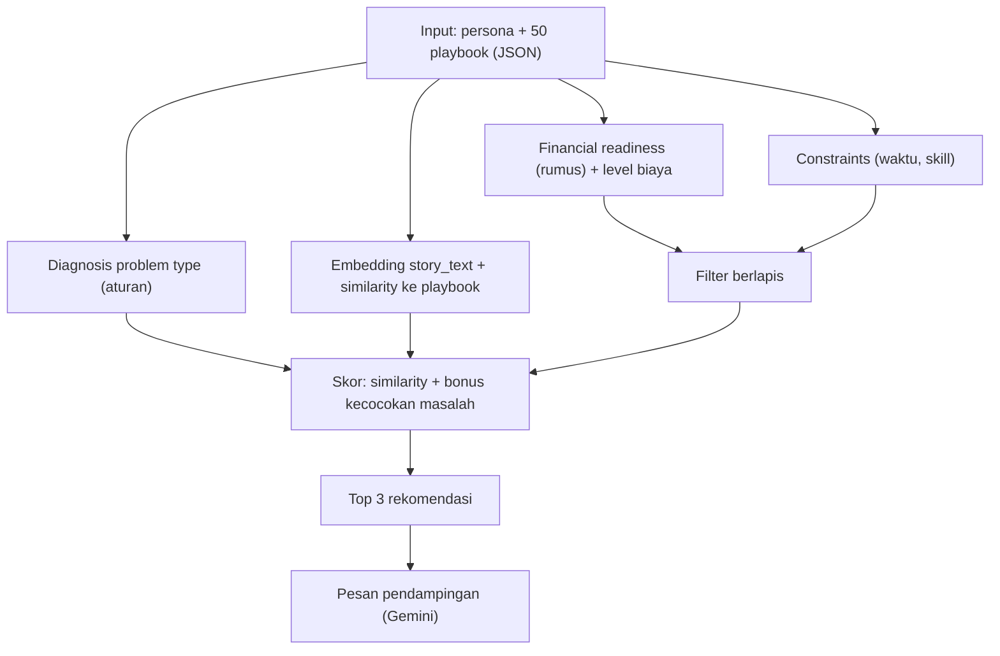

# Elevate Puan: Pipeline Awal Rekomendasi Strategi Eksperimen untuk UMKM

**Kelompok:** Dewi Sartika | **Anggota:** Khalida, Youfih, Devi, Anggita
**Program:** Bootcamp Perempuan Inovasi GENErasi AI 2026 (AI Full Stack Web Development)

## 1. Problem dan pengguna sasaran

**Pengguna sasaran:** perempuan pemilik UMKM di Indonesia yang ingin mengembangkan usahanya tetapi belum tentu punya akses ke konsultan bisnis atau mentor yang mendampingi secara rutin.

**Problem yang diselesaikan:**
1. Sulit mendiagnosis penyebab bisnis jalan di tempat.
2. Bingung memilih strategi dari banyak tips bisnis yang belum tentu cocok dengan kondisi usahanya.
3. Strategi yang bagus di atas kertas sering gagal dijalankan karena modal, waktu, atau kemampuan pemilik tidak mencukupi.
4. Hasil strategi tidak dicatat sehingga tidak ada pembelajaran untuk langkah berikutnya.

## 2. Fitur yang dipilih dan perannya dalam final project

**Fitur utama: AI Solution Recommendation**, yaitu rekomendasi strategi eksperimen pertumbuhan 7 hari yang personal dan aman secara finansial.

**Metode:** recommendation system *content-based* dengan pretrained embedding model (`paraphrase-multilingual-MiniLM-L12-v2`) dan kemiripan semantik, dilengkapi diagnosis berbasis aturan, perhitungan kesiapan finansial (rumus tetap), filter berlapis, dan skor gabungan. Hasil akhirnya diterjemahkan menjadi pesan pendampingan oleh Gemini. Tidak ada pelatihan model dari awal.

**Peran dalam final project:** fitur ini berada di tengah alur pengguna, setelah assessment, financial readiness, dan constraints, dan sebelum eksperimen aktif, hasil, dan growth insight.

| | Isi |
|---|---|
| **Input** | Data persona (14 jawaban assessment, 5 data finansial, 3 constraints, riwayat eksperimen) dan database playbook strategi |
| **Output** | Top 3 strategi eksperimen beserta kategori masalah, level biaya, skor, dan rencana aksi 7 hari, serta pesan pendampingan dari Gemini |

## 3. Data dan input yang digunakan

| Data | Isi | Sumber | Status |
|---|---|---|---|
| `personas_data.json` | 3 persona fiktif: Bu Rina, Kak Dinda (skincare), Bu Sari | Dibuat tim berdasarkan desain assessment | Data contoh, **bukan data pengguna nyata** |
| `playbooks_data.json` | 50 playbook strategi: `playbook_id`, `title`, `problem_type`, `description`, `cost_level`, `cost_estimated`, `min_digital_skill`, `min_hours_per_week`, `day_by_day_plan` | [ISI: sumber penyusunan, misalnya disusun tim dan dibantu AI] | [ISI: status verifikasi] |
| Assessment | 14 pertanyaan (kategori usaha, kebiasaan pembeli, kendala operasional, tantangan terbesar, cerita bebas, tujuan, dll.) | Desain tim, mengacu pada World Bank dan ILO | Dirancang tim |
| Finansial | `monthly_revenue`, `monthly_operating_cost`, `household_need`, `product_margin_pct`, `willingness_to_lose` | Desain tim (konsep Affordable Loss) | Rumus tetap |

## 4. Alur analisis (pipeline)

1. **Diagnosis:** `diagnose_problem_type` mencocokkan jawaban assessment dengan aturan untuk menghasilkan satu atau lebih jenis masalah.
2. **Financial readiness:** `laba = omzet - biaya`, `sisa bebas = laba - kebutuhan rumah tangga`, `batas aman = sisa bebas x persentase risiko (15/20/25%)`, `rekomendasi = MIN(batas aman, anggaran yang siap diuji)`. Hasilnya menentukan level biaya (1 sampai 3).
3. **Constraints:** waktu dan kemampuan digital dipakai sebagai filter.
4. **Semantic search:** `story_text` pengguna dan deskripsi playbook diubah menjadi embedding, lalu dibandingkan dengan perkalian titik (setara cosine similarity karena sudah dinormalisasi).
5. **Filter:** playbook dengan level biaya di atas level yang terbuka, kemampuan digital yang melebihi pengguna, atau kebutuhan jam yang terlalu besar akan dibuang.
6. **Skor:** `skor akhir = similarity + 0,35` jika jenis masalah playbook ada di hasil diagnosis.
7. **Output:** 3 skor teratas ditampilkan dengan rencana aksi 7 hari, lalu Gemini menulis pesan pendampingan dari data tersebut.

## 5. Cara menjalankan

1. Buka notebook `notebooks/ElevatePuan_Recommendation_LLM_Pipeline.ipynb` di Google Colab.
2. Jalankan sel dari atas ke bawah. Saat diminta, unggah `data/personas_data.json` dan `data/playbooks_data.json`.
3. Ubah `PILIHAN_PERSONA` (`bu_rina`, `kak_dinda`, atau `bu_sari`) untuk mencoba persona lain.
4. Untuk bagian Gemini, simpan API key di Colab Secrets dengan nama `GEMINI_API_KEY`. Tanpa key, abaikan sel Gemini. **Jangan menyimpan API key di repository.**

Dependensi ada di `requirements.txt`.

## 6. Hasil awal dan interpretasi

**Persona yang diuji: Kak Dinda (skincare)**

| Tahap | Hasil |
|---|---|
| Finansial | Laba Rp3.000.000, sisa uang bebas Rp1.500.000, batas aman (25%) Rp375.000, rekomendasi anggaran Rp300.000, status `within_range` (hijau), level 3 terbuka |
| Constraints | Waktu 5+ jam per minggu, kemampuan digital sedang (level 2) |
| Filter | 3 dari 50 playbook lolos |

**Top 3 rekomendasi**

| Peringkat | Playbook | Level biaya | Skor akhir | Semantik |
|---|---|---|---|---|
| 1 | pb-027 Flash Sale Terbatas Durasi 3 Jam di Media Sosial | 1 (Rp0) | 0,873 | 0,523 |
| 2 | pb-040 Uji Coba Penjualan Konsinyasi di Kantin / Toko Mitra | 2 (Rp100.000) | 0,756 | 0,406 |
| 3 | pb-044 Kerjasama Reseller Tanpa Modal (Dropship Lokal) | 1 (Rp0) | 0,686 | 0,336 |

**Interpretasi singkat:**
- Anggaran Rp300.000 dan level 3 membuat hampir semua playbook lolos filter. Ketiga rekomendasi berbiaya Rp0 sampai Rp100.000, masih di bawah anggaran.
- Skor akhir tertinggi berasal dari gabungan kemiripan semantik dan bonus jenis masalah. Selisih skor akhir antar peringkat lebih banyak dipengaruhi oleh bonus +0,35 dibanding oleh kemiripan semantik.
- Ketiga strategi bersifat memperluas jangkauan dan saluran penjualan (flash sale, konsinyasi, reseller). Cerita Kak Dinda menyebut "banyak yang DM tanya harga lalu hilang", yang lebih dekat ke masalah konversi (calon pembeli ragu atau pergi setelah bertanya).
- **Temuan:** aturan diagnosis mencari teks jawaban yang persis, dan teks pada persona ("...sedikit yang membeli") berbeda dari teks di aturan ("...sebagian membeli"). Akibatnya jenis masalah konversi belum terdeteksi. 

**Catatan penting:** skor kemiripan hanya dipakai untuk mengurutkan, bukan probabilitas keberhasilan.

## 7. Pengujian

| Pengujian | Hasil |
|---|---|
| Perhitungan finansial dengan persona Kak Dinda | Sesuai rumus (lihat tabel di atas) |
| Diagnosis dengan data contoh (`sample_user`) | Menghasilkan `low_conversion`, `weak_retention`, dan `narrow_market` |
| Filter berlapis | 3 dari 50 playbook lolos untuk Kak Dinda |

## 8. Keterbatasan

- Data persona fiktif dan playbook belum diverifikasi oleh pelaku UMKM nyata.
- Diagnosis berbasis pencocokan teks persis sehingga rentan terhadap perbedaan penulisan jawaban. Memakai kode jawaban tetap akan lebih aman.
- Filter jam kerja baru berlaku untuk pilihan "3 – 5 jam".
- Pencarian semantik hanya memakai `story_text`, belum memakai hasil diagnosis dan tujuan pengguna.
- Biaya playbook belum dibandingkan langsung dengan anggaran rekomendasi (hanya dengan level biaya). [ISI: hapus jika sudah ditambahkan]
- Bonus +0,35 bersifat tetap dan belum diuji bobot lainnya.
- Pesan dari Gemini belum divalidasi oleh aturan, dan ini sifatnya hanya narasi.
- Evaluasi masih pada satu persona dan belum memakai metrik terukur.

## 9. Langkah pengembangan berikutnya

1. Memakai kode jawaban tetap pada assessment dan menyelaraskan nama jenis masalah antara diagnosis dan playbook.
2. Menambahkan pengecekan anggaran, gerbang kapasitas, dan riwayat eksperimen pada filter dan skor.
3. Menguji ketiga persona dan membuat dataset uji dengan metrik sederhana.
4. Memverifikasi playbook dengan sumber tepercaya (misalnya ILO SIYB/IYB, Kemenkop UKM) dan wawancara pelaku UMKM.
5. Mengubah pipeline menjadi layanan FastAPI dan menghubungkannya ke aplikasi web Next.js dan database Supabase.
6. Menambah pengaman pada narasi Gemini (hanya memakai data terstruktur, memeriksa angka, dan teks cadangan).
